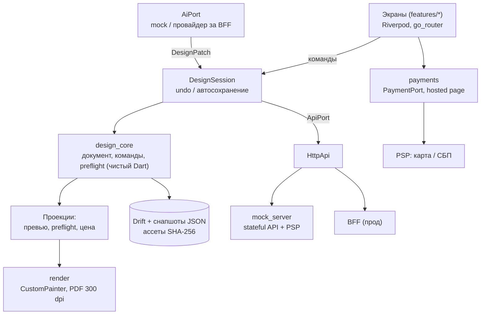

# PicPac Mobile

Мобильный канал заказа фотопродукции PicPac (трек 2): путь от фото на телефоне до оформленного заказа
за три действия. iOS + Android, Flutter. Mock API встроен в приложение — демо работает без сервера.

## 0. Задача, роли, стек

**Задача.** Сократить путь «фото на телефоне → готовый заказ»: каталог и цены из API, сборка проекта из
фото, редактор на слотах и шаблонах (не свободный холст), проверка макета до оплаты, тестовый заказ,
статусная лента, история и поддержка.

**Роли.**
| Роль | Что может | Проверка |
|---|---|---|
| гость | каталог, идеи, сборка проекта, поиск заказа по номеру | сервер: checkout/история → 403 |
| `customer` | свои заказы, оплата, тикеты | сервер: чужие объекты → 403 |
| `support_agent` | консоль поддержки: все заказы и тикеты, ответы клиентам, смена статуса заказа, журнал аудита | сервер: роль в токене, чужие объекты и админ-методы → 403 |

**Две роли с разными правами (ОТ-02).** В приложении две полноценные роли: `customer` и `support_agent`.
Права проверяются на сервере по роли из токена, а не в интерфейсе: клиент не может открыть чужой заказ,
тикет или журнал аудита; поддержка видит все обращения и меняет статус заказа. Консоль поддержки — отдельный
раздел приложения (вкладка «Поддержка»), клиент её не видит.

**Стек.** Flutter 3.47 / Dart 3.13, Riverpod, go_router, Drift, dio, `pdf`, `share_plus`, `image_picker`,
`flutter_secure_storage`. Рендер — `CustomPainter` + `PictureRecorder`. Пакеты: `design_core` (чистый Dart),
`api_contract` (DTO/порты), `mock_server` (Shelf).

**Переменные окружения** (подробнее — `docs/env.md`):
| Переменная | Значения | По умолчанию |
|---|---|---|
| `API_MODE` | `embedded` \| `http` | `embedded` |
| `API_BASE_URL` | абсолютный URL | — (обязателен для `http`) |
| `APP_ENV` | `dev` \| `staging` \| `prod` | `dev` |
| `AI_ENABLED` | `true` \| `false` | `false` |
| `AI_PROVIDER` (сервер) | `none` \| `mock` \| `agent` | `mock` |
| `AGENT_BASE_URL`, `AGENT_MODEL`, `AGENT_API_KEY` (сервер) | адрес/модель/ключ провайдера | — |

Секретов в репозитории нет; ключи провайдера живут только в env сервера.

---

## 1. Pre-built

### Android
```
deliverables/picpac-demo.apk
```
```sh
adb install -r deliverables/picpac-demo.apk
adb shell monkey -p by.picpac.picpac_mobile -c android.intent.category.LAUNCHER 1
```
Или скопировать APK на телефон и открыть (разрешить установку из неизвестного источника).

### iOS
- `deliverables/Runner-simulator.app` — симулятор:
  ```sh
  xcrun simctl boot "iPhone 18 Pro"
  xcrun simctl install "iPhone 18 Pro" deliverables/Runner-simulator.app
  xcrun simctl launch "iPhone 18 Pro" by.picpac.picpacMobile
  ```
- `deliverables/picpac-demo-unsigned.ipa` — для устройства, требует переподписи вашим Team ID
  (`flutter build ipa` после настройки Signing в Xcode).

**Windows:** официально `ipa` на Windows не устанавливается и не запускается — нужен macOS
(или Mac in the Cloud / CI с macOS-раннером). Android-APK на Windows ставится штатно через `adb`.

---

## 2. Сборка из исходников

Нужно: Flutter 3.47+ (Dart 3.13+), Xcode 16+ для iOS, Android SDK 35+, JDK 17+.

```sh
flutter pub get
flutter run                 # эмулятор/симулятор, mock внутри приложения
```

Релизные сборки:
```sh
flutter build apk --release
flutter build ios --release            # macOS, нужна подпись
flutter build ipa                      # macOS, нужна подпись
```

Отдельный mock-сервер (по желанию):
```sh
./scripts/dev-api.sh            # http://127.0.0.1:8080
./scripts/dev.sh ios            # приложение + сервер
```

### Нюанс iOS: self-hosting и оплата
Приложение не принимает карточные данные: оплата открывается в системном браузере на hosted-странице
провайдера. Для собственного размещения нужно, чтобы домен оплаты был доступен по HTTPS и принимался
провайдером; Apple требует, чтобы цифровые товары шли через IAP — здесь продаётся физический товар
(печать), поэтому внешняя оплата допустима, но домен и оферта должны быть публичными.

---

## 3. Тестовые данные и повторная загрузка

| Роль | Логин | Пароль |
|---|---|---|
| customer | `customer@picpac.test` | `Test1234` |
| support_agent | `support@picpac.test` | `Test1234` |

- Регистрация нового аккаунта — на экране входа, кнопка «Создать аккаунт» (`POST /v1/auth/register`).
  Аккаунт живёт в памяти mock: после перезапуска приложения используйте демо-учётки выше.
- Промокоды: `TEST10` (−10 %), `PIC100` (итог 0, заказ сразу оплачен).
- Повторная загрузка данных: `packages/mock_server/seeds/*.json` (каталог, доставка, оплата, идеи, аккаунты).
  После правки: `cd packages/mock_server && dart run tool/embed_seeds.dart` и пересобрать приложение.
- Сброс состояния mock во время работы: `POST /v1/mock/reset` (dev, роль `support_agent`).

Синтетические данные: цены/форматы — снимок 09.11.2026, фото-фикстуры — сгенерированные градиенты,
персональных данных нет.

---

## 4. Отчёт о тестировании

Проверялось на iOS-симуляторе (iPhone 18 Pro, iOS 27) и Android (эмулятор API 37, физическое устройство
Xiaomi Mi 10T Pro), плюс автотесты.

| Проверка | Результат |
|---|---|
| `flutter analyze` | 0 issues |
| `dart format --set-exit-if-changed .` | 0 changed |
| Юнит/виджет-тесты | 400+ тестов: `design_core` 151, `api_contract` 56, `mock_server` 116, приложение — остальное |
| E2E сценарий | каталог → 10 фото (включая HEIC) → улучшение → 4 листа → preflight → корзина 5,20 BYN → заказ |
| HEIC | конвертация в JPEG, EXIF/GPS вычищены, ориентация запечена (iOS + Android) |
| Идемпотентность | повтор checkout с тем же ключом возвращает тот же заказ |
| Офлайн | черновик сохраняется, заказ уходит в очередь с тем же ключом |
| Роли | гость/клиент/поддержка, права проверяются сервером (403) |
| Аудит | каждая мутация: актор, время, действие, объект, результат |
| Производительность | p95 кадра 3.6 мс на 244 кадрах жеста; PDF 10 листов ≈ 4 с |

Ограничения текущей итерации: асинхронные банковские способы подключаются в следующем релизе.

---

## 5. Структура

```
lib/            приложение (app, core, ai, payments, render, features)
packages/
  design_core/  документ, команды, undo, preflight, шаблоны (чистый Dart)
  api_contract/ DTO, ApiPort, деньги, ошибки (без Flutter)
  mock_server/  stateful mock API + PSP-симулятор
assets/         шрифт Futura PT, логотип, иконки
deliverables/   готовые сборки
```


## 6. Mock API

Stateful-сервер, повторяющий контракт BFF. Запуск: `./scripts/dev-api.sh` (порт 8080), либо встроенный
режим `API_MODE=embedded`.

| Метод | Путь | Назначение |
|---|---|---|
| POST | `/v1/auth/anonymous` | гостевая сессия |
| POST | `/v1/auth/register` | регистрация |
| POST | `/v1/auth/login` | вход по email/паролю |
| POST | `/v1/auth/verify` | вход по коду |
| GET / DELETE | `/v1/me` | профиль / удаление аккаунта |
| GET | `/v1/catalog`, `/v1/catalog/{id}`, `/v1/catalog/{id}/formats` | каталог, форматы, шаблоны |
| POST | `/v1/price` | цена, ETA, preflight |
| GET | `/v1/delivery/options`, `/v1/pickup/points` | доставка и самовывоз |
| POST | `/v1/uploads/presign`, `/v1/uploads/{id}/complete`, DELETE `/v1/uploads/{id}` | загрузка фото |
| POST / GET / PUT / DELETE | `/v1/designs`, `/v1/designs/{id}` | черновики, `If-Match` ревизии |
| POST | `/v1/designs/{id}/preflight` | серверная проверка макета |
| GET / POST / PATCH / DELETE | `/v1/cart`, `/v1/cart/items`, `/v1/cart/items/{id}` | корзина |
| POST | `/v1/checkout`, `/v1/orders` | заказ (Idempotency-Key) |
| GET | `/v1/orders`, `/v1/orders/{id}` | история и заказ |
| POST | `/v1/orders/lookup`, `/v1/orders/{id}/claim` | поиск по номеру, привязка |
| GET | `/v1/payments/methods` | способы оплаты по региону |
| POST / GET | `/v1/orders/{id}/payment-intent`, `/v1/payments/{id}` | платёжный intent и его статус |
| POST | `/v1/webhooks/psp/{provider}` | вебхук провайдера (HMAC) |
| POST | `/v1/orders/{id}/refunds`, GET `/v1/orders/{id}/receipt` | возврат, чек |
| GET / POST | `/v1/support/tickets`, `/v1/support/tickets/{id}/messages` | поддержка |
| GET | `/v1/audit` | журнал действий (роль поддержки) |
| GET | `/v1/inspiration`, `/v1/favorites` | лента шаблонов и избранное |
| POST | `/v1/ai/patch` | AI-предложение (`DesignPatch`) |

### Примеры запросов

```sh
BASE=http://127.0.0.1:8080/v1
TOKEN=$(curl -s -X POST $BASE/auth/login -H 'content-type: application/json' \
  -d '{"email":"customer@picpac.test","password":"Test1234"}' | jq -r .token)

curl -s $BASE/catalog -H "authorization: Bearer $TOKEN"
curl -s -X POST $BASE/price -H "authorization: Bearer $TOKEN" -H 'content-type: application/json' \
  -d '{"productId":"photo_print","formatId":"10x15","photosCount":10,"spreadsCount":10}'
curl -s -X POST $BASE/checkout -H "authorization: Bearer $TOKEN" \
  -H 'idempotency-key: demo-1' -H 'content-type: application/json' \
  -d '{"cartId":"…","delivery":{"kind":"pickup","optionId":"pickup_main","pointId":"main"},
       "contact":{"name":"Тест","phone":"+375291234567"}}'
```

Служебные dev-эндпоинты mock (`/v1/mock/*`) не входят в контракт BFF и отключены вне dev.


## 7. Маршруты приложения (go_router)

| Путь | Экран | Доступ |
|---|---|---|
| `/catalog` | каталог, стартовый экран | все |
| `/catalog/:productId` | карточка продукта, форматы, опции | все |
| `/inspiration` | лента идей (готовые шаблоны) | все |
| `/inspiration/:id` | деталь шаблона, «Применить» | все |
| `/projects` | мои проекты (черновики) | все |
| `/create/:designId` | проект: сетка фото, импорт, «Улучшить все» | все |
| `/editor/:designId` | редактор: 8 инструментов, undo | все |
| `/preflight/:designId` | проверка макета (открывается как шторка) | все |
| `/cart` | корзина | сессия/аккаунт |
| `/checkout` | оформление: доставка, контакт, промо | аккаунт |
| `/orders` | история заказов | аккаунт |
| `/orders/lookup` | поиск заказа по номеру (гость) | все |
| `/orders/:orderId` | заказ: две оси статусов, оплата, чек | владелец/гость по номеру |
| `/support` | поддержка: тикеты, тред | аккаунт |
| `/support/:ticketId` | конкретное обращение | владелец |
| `/profile` | профиль, язык, очередь, удаление | сессия |
| `/login` | вход и регистрация, `?next=` | все |
| `picpac://orders/{number}` | deep link → `/orders/lookup?number=…` | все |

Редиректы: гость на `/checkout` и `/orders` уходит на `/login?next=<исходный путь>`; поддержка имеет
только консоль и профиль; неизвестный путь — экран 404.


## 8. Архитектура и потоки данных



| Слой | Ответственность | Правило |
|---|---|---|
| `design_core` | документ, команды, undo, preflight, шаблоны | только Dart SDK, без Flutter и HTTP |
| `api_contract` | DTO, `ApiPort`, деньги, ошибки | без Flutter |
| `mock_server` | stateful API, PSP-симулятор, аудит | без Flutter, вне продакшена |
| `lib/app` | bootstrap, роутер, тема, DI | единственная точка сборки |
| `lib/core` | сессия, хранилище, экспорт, настройки | инфраструктура, без UI-фич |
| `lib/features/*` | экраны и их состояние | не импортируют друг друга |
| `lib/render` | сцена, hit-test, PDF | зависит от `design_core` |
| `lib/payments` | платёжный контекст | не зависит от заказов |
| `lib/ai` | контекст и патчи | не пишет в документ напрямую |

**Поток заказа:** каталог → `POST /price` → проект (локальный документ) → preflight → корзина →
`POST /checkout` (Idempotency-Key) → заказ **до** оплаты → payment intent → hosted page → webhook/`GET /payments/{id}`
→ статусная лента. Деньги и ETA считает только сервер; клиент показывает ответ.


## 9. Демо за 5–7 минут

Полный сценарий — `DEMO.md`. Коротко:
1. Каталог → «Печать фотографий» 10×15 → «Собрать» (30 с).
2. Красный «+» → 10 фото, порядок перетаскиванием (60 с).
3. Редактор: «Улучшить все», «4 листа вместо 10», 8 инструментов (60 с).
4. Иконка проверки у «Оформить заказ»: info/warning/error + замечания (30 с).
5. Корзина: 4 листа, 5,20 BYN с сервера (20 с).
6. Вход `customer@picpac.test / Test1234` → checkout → заказ `PP-…` (60 с).
7. Оплата: картой → hosted page → возврат → «Оплачен» (60 с).
8. «Demo push»: статус двигается, приходит уведомление (15 с).
9. Поддержка: тикет из заказа, ответ (30 с).
10. Профиль: язык RU/BY, очередь, удаление данных (20 с).

## 10. AI‑контур (для трека 2: провайдер, данные, защита)

- Модель не имеет доступа к документу: возвращает только `DesignPatch` (allowlist операций, clamp,
  проверка ссылок), невалидный патч отклоняется целиком, применение — один undo.
- В модель уходит: интент, локаль, сводка документа, спецификация печати, статистика кадра и **превью
  512–768 px**. Никогда: оригиналы, `sha256`, пути к файлам, PII.
- Провайдер (opencode/pi) стоит за BFF; ключи только в env сервера; в приложении их нет.
- Fallback: детерминированные правила (`MockAi`) работают офлайн — демо не зависит от сети.
- Метаданные воспроизводимости: `skill_version`, `tool_schema_version`, `model`, `prompt_hash`.

Контрольные вопросы и ожидаемые ответы — `DEMO.md`, раздел «Вопросы комиссии».

## 11. Границы текущей итерации

- Демонстрационный контур работает на mock API; боевой BFF подключается по тому же контракту (`ApiPort`).
- Асинхронные банковские способы — следующий релиз; карта и оплата при получении работают.
- Сборки для iOS подписываются ключом команды (Team ID) — стандартный процесс App Store Connect.
